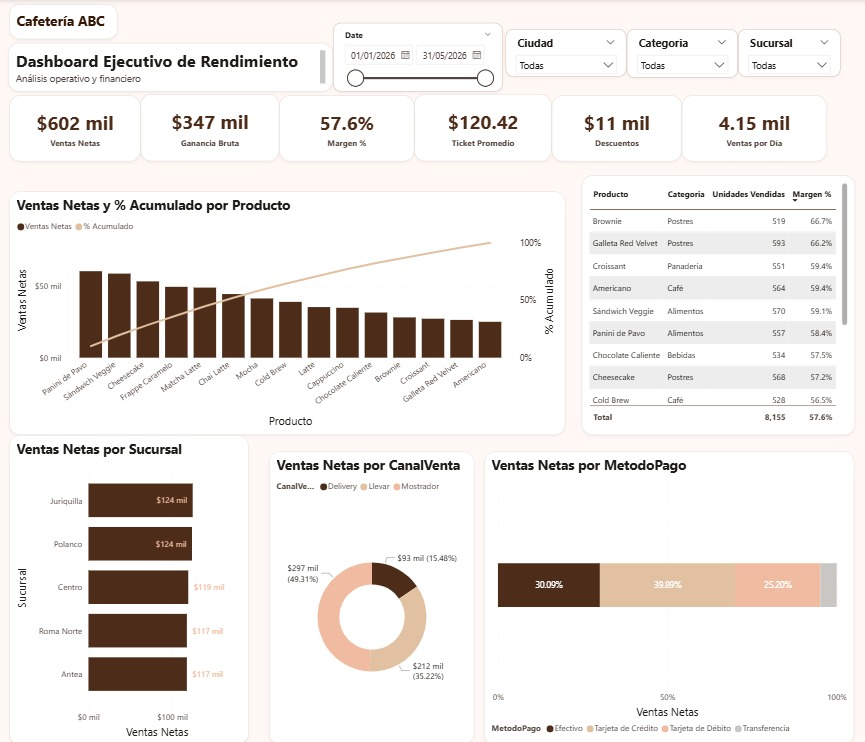

[README.md](https://github.com/user-attachments/files/33608069/README.md)
# ☕ Cafetería ABC — Dashboard Ejecutivo de Rendimiento

**En una línea:** dashboard de Power BI que responde, para una cadena de 5 cafeterías (Querétaro y CDMX), qué se vende, qué deja más margen y cómo se mueven las ventas por sucursal, canal y método de pago. Construido en formato PBIP para versionarlo en Git.

**Stack:** Power BI Desktop · Power Query (M) · DAX · modelo en estrella · formato PBIP/TMDL

> ⚠️ **Datos sintéticos:** las 5,000 transacciones (enero a mayo 2026) son datos de ejemplo generados para este proyecto; no son cifras de un negocio real. Los hallazgos de abajo describen esos datos y sirven para mostrar el tipo de lectura que permite el dashboard.



## 🎯 Preguntas de negocio que responde
- ¿Cuánto vendemos, cuánto ganamos y qué tan rentable es cada producto?
- ¿Qué productos concentran las ventas y cuáles dejan más margen?
- ¿Cómo se reparten las ventas entre sucursales, canales de venta y métodos de pago?

## 📊 Qué muestra el dashboard
- **KPIs:** Ventas Netas, Ganancia Bruta, Margen %, Ticket Promedio, Descuentos y Ventas por Día.
- **Análisis 80/20 (Pareto)** de productos por ventas netas, con porcentaje acumulado.
- **Top productos más rentables**, ordenados por margen %.
- **Ventas por sucursal**, distribución por canal (Mostrador / Llevar / Delivery) y desglose por método de pago.
- **Filtros** por fecha, ciudad, sucursal y categoría de producto.

El repositorio incluye el mockup de referencia en [`mockup_diseño/`](mockup_diseño/).

## 🔎 Hallazgos (sobre los datos de ejemplo)

| Indicador | Resultado |
|---|---|
| Ventas netas (ene a 25 may 2026) | **$602,106** en 5,000 transacciones |
| Ganancia bruta / margen | **$346,643 · 57.6%** |
| Ticket promedio | **$120.4** |
| Descuentos | 21% de las transacciones llevan descuento; restan **1.7%** de la venta bruta |

- **El Pareto no es pronunciado:** hacen falta **11 de 15 productos** para llegar al 80% de las ventas. Los 3 primeros (Panini de Pavo, Sándwich Veggie, Cheesecake) suman 28.5%. No hay un producto que dependa de pocos "estrella".
- **Margen por categoría:** Postres lidera con **61.9%**; Bebidas es la más baja con **54.8%**. El **Brownie (66.7%)** y la **Galleta Red Velvet (66.2%)** son los productos de mayor margen; el **Frappe Caramelo (53.2%)** es el de menor margen y aun así es el 4.º en ventas.
- **Ticket por categoría:** Alimentos tiene el ticket más alto (**$173.8**) frente al promedio de **$120.4**.
- **Sucursales parejas:** Juriquilla (20.7%) y Polanco (20.5%) lideran; Antea y Roma Norte (19.5%) cierran. La diferencia entre la mejor y la peor es de ~6%.
- **Canal:** Mostrador 49.3%, Llevar 35.2%, Delivery 15.5%. El margen es el mismo (57.6%) en los tres porque los datos no incluyen comisiones de plataformas de delivery.
- **Pago:** tarjeta de crédito 39.9%, efectivo 30.1%, débito 25.2% y transferencia 4.8%.
- **Ojo al comparar meses:** febrero tiene 28 días y mayo llega solo hasta el día 25, así que comparar ventas totales entre meses engaña. Las ventas por día se mantienen entre $4.0k y $4.3k todos los meses; por eso el dashboard incluye la tarjeta **Ventas por Día** (**$4.15 mil** en el período).

## 🧮 Definición de las medidas
- **Ventas Netas** = Cantidad × Precio × (1 − Descuento)
- **Ganancia Bruta** = Ventas Netas − Cantidad × Costo
- **Margen %** = Ganancia Bruta / Ventas Netas
- **Ticket Promedio** = Ventas Netas / número de transacciones
- **Ventas por Día** = Ventas Netas / días con ventas

## 🗂️ Modelo de datos
Esquema en estrella con una tabla de hechos y tres dimensiones:
- **Ventas** (hechos) → relacionada con **Productos**, **Sucursales** y **Calendario**.
- **_Medidas:** tabla auxiliar con las métricas DAX (Ventas Netas, Ganancia Bruta, Margen %, Ticket Promedio, variaciones vs. mes anterior, ranking y % acumulado para el Pareto, participación por canal y método de pago).

## ⚠️ Limitaciones
- Datos sintéticos: no reflejan comportamiento real de clientes ni estacionalidad.
- El margen es **bruto** (precio menos costo del producto): no incluye renta, nómina ni comisiones de delivery.
- Sin segmentación de clientes ni horarios con patrón marcado en los datos de ejemplo.

## 🚀 Cómo abrirlo
1. Instala [Power BI Desktop](https://powerbi.microsoft.com/desktop/) (gratis).
2. Clona este repositorio.
3. Abre `PBI/proyecto.pbip`.
4. Si Power BI no encuentra los CSV automáticamente, actualiza el parámetro `RutaDatos` (Inicio → Transformar datos → Editar parámetros) para que apunte a tu copia local de la carpeta `Datos/`.
5. Inicio → Actualizar, para cargar los datos.

## 📁 Estructura del repositorio
```
project_bi/
├── Datos/                          # Fuentes de datos (CSV)
│   ├── Ventas.csv                  # 5,000 transacciones (ene-may 2026)
│   ├── Productos.csv               # Catálogo de 15 productos
│   └── Sucursales.csv              # 5 sucursales (Querétaro y CDMX)
├── PBI/                            # Proyecto de Power BI (formato PBIP)
│   ├── proyecto.pbip               # Archivo raíz
│   ├── proyecto.SemanticModel/     # Modelo de datos (tablas, relaciones, medidas DAX en TMDL)
│   ├── proyecto.Report/            # Definición del reporte y sus visuales
│   ├── tema_personalizado_abc.json # Tema visual (paleta y tipografía)
│   └── plan_implementacion_dashboard.md
├── images/                         # Capturas del dashboard
└── mockup_diseño/                  # Referencia de diseño (mockup, guía de estilo)
```

## 👤 Autor
**Héctor Estéfano Gómez Vigo** · Estudiante de Estadística e Informática (UNALM)
[LinkedIn](https://www.linkedin.com/in/h%C3%A9ctor-est%C3%A9fano-g%C3%B3mez-9b6079289/)
